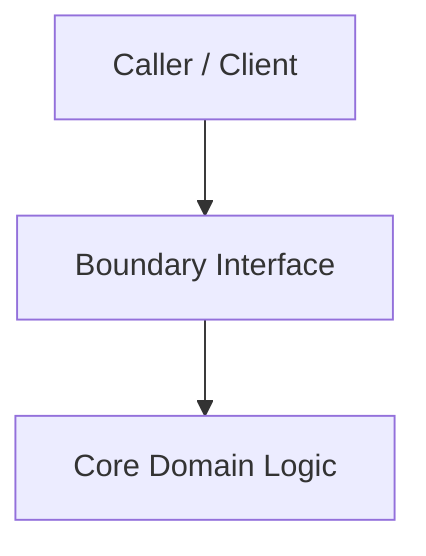

# ADR-NNNN: [Short Title of Architectural Decision]

- **Status**: [Proposed | Accepted | Rejected | Superseded by ADR-XXXX]
- **Date**: YYYY-MM-DD
- **Deciders**: [List stakeholders or agents]

## Context & Problem Statement
[What is the context, driving technical forces, and motivation for this decision? What problem are we solving?]

## Decision
[What is the chosen approach, pattern, or boundary contract?]

## Ponytail Rule Verification
[Explicitly explain why simpler alternatives (e.g. Python standard library, existing project helpers) are insufficient and why this specific abstraction or dependency is strictly necessary.]

## Alternatives Considered
- **Alternative 1**: [Description and reason for rejection]
- **Alternative 2**: [Description and reason for rejection]

## Consequences & Trade-offs
- **Positive**: [What becomes easier, faster, or safer]
- **Negative / Risks**: [What complexity or operational overhead is introduced]

## Architecture Diagram

